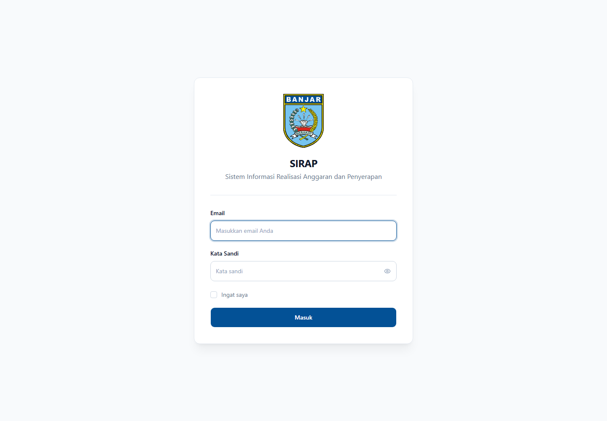
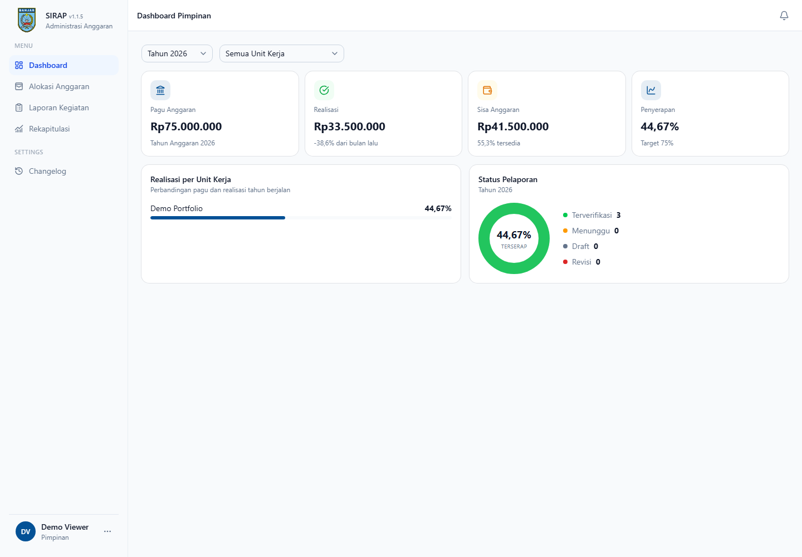
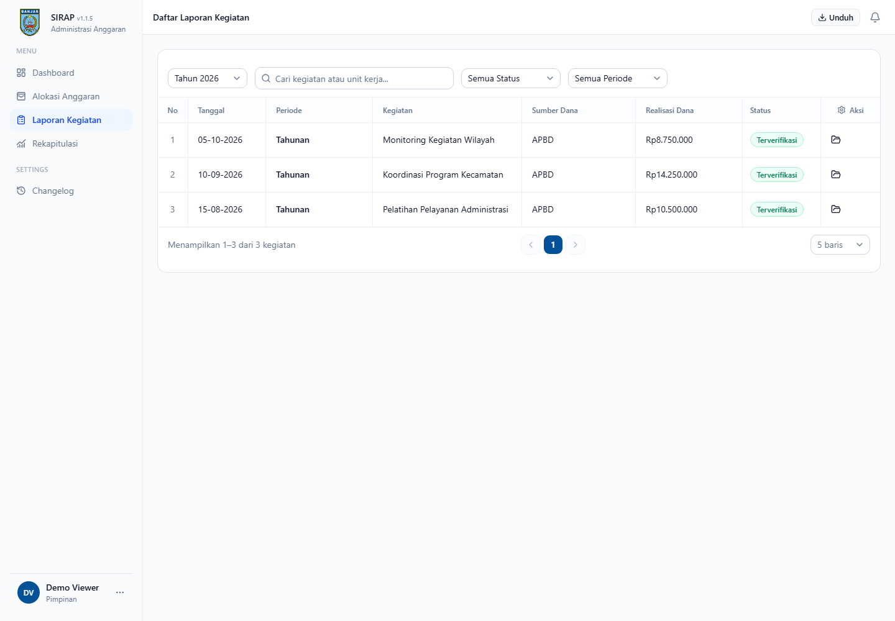
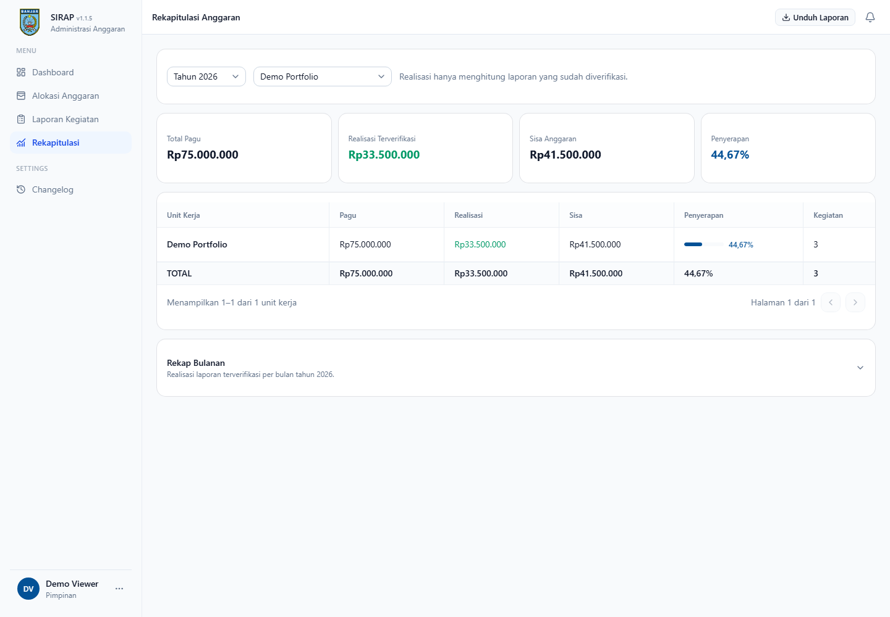

# SIRAP — Sistem Informasi Realisasi Anggaran dan Penyerapan

*District Budget Realisation Reporting Workflow*

## Ringkasan

SIRAP adalah aplikasi web untuk mencatat, meninjau, dan memantau realisasi
anggaran pada tingkat kecamatan. Setiap peran memiliki alur kerja yang jelas,
mulai dari pelaporan kegiatan hingga verifikasi bertahap, dengan alokasi,
bukti pendukung, dan kontrol pelaporan yang terhubung dalam satu sistem.

SIRAP is a web application for recording, reviewing, and monitoring budget
realisation at the district-government level. It gives each role a focused
workflow—from activity reporting to staged review—while keeping allocations,
evidence, and reporting controls connected in one system.

## Overview

Public-sector budget reporting is often spread across spreadsheets, messages,
and manually collected evidence. SIRAP brings that process into a traceable
workflow: staff record activity realisation, reviewers check submissions in
sequence, and authorised users can monitor allocation use and export reports.

The interface is intentionally in Indonesian for its operational users. This
repository presents the product and its engineering decisions in Indonesian
and English; the application source remains private.

## Demo Access

Selected, sanitised screenshots are shared during a private walkthrough of the
workflow. Please contact
[m.noor.aditya.rahman@gmail.com](mailto:m.noor.aditya.rahman@gmail.com) to
arrange access.

## Screenshots / Tampilan Aplikasi

Tampilan di bawah hanya menggunakan data portofolio fiktif yang sudah
disanitasi. Gambar ini memperlihatkan antarmuka berbahasa Indonesia dan alur
pelaporan utama tanpa membuka lingkungan aktif, kredensial, atau catatan
operasional.

The screens below use fictional, sanitised portfolio data only. They illustrate
the Indonesian interface and core reporting workflow without exposing a live
environment, credentials, or operational records.

| Masuk / Login | Dashboard Pimpinan / Leadership dashboard |
| --- | --- |
|  |  |

| Daftar Laporan Kegiatan / Activity reports | Rekapitulasi Anggaran / Budget recap |
| --- | --- |
|  |  |

## Key Capabilities

- Budget allocation management with ceiling-aware reporting controls.
- Activity realisation reports with structured expense details and supporting
  evidence.
- Staged review flow for staff, section leadership, and management roles.
- Role-based access control that limits data and actions to the appropriate
  work unit and responsibility.
- Budget recaps and CSV, XLSX, and PDF exports for reporting workflows.

## Technology

- Laravel and PHP for the application backend.
- Inertia.js, React, TypeScript, and Tailwind CSS for the interface.
- PostgreSQL for relational data.
- Spatie Laravel Permission for role-based access control.
- Docker for reproducible development and deployment environments.

## Engineering Quality

SIRAP is built around server-side validation and authorisation rather than
UI-only restrictions. Budget calculations use decimal-safe comparisons,
uploads are constrained by type and size, and evidence is kept behind
application access controls.

The project also maintains automated backend and frontend checks. Recent
hardening work covers session invalidation after sensitive account changes,
cross-role access controls, disabled public registration, safer exports, and
production-safe error handling.

## Remote Collaboration

The project is maintained with reviewable commits, documented environment
conventions, automated checks, and container-based workflows. Those practices
make the work easier to understand, review, and continue across asynchronous
teams.

## Case Study

- [Indonesian client case study](docs/portfolio-case-study.id.md)
- [Sanitized conceptual architecture](docs/architecture.md)
- [Private demo access policy](docs/demo-publication-checklist.md)
- [Responsible disclosure policy](SECURITY.md)

## Contact

For technical discussion or a private source review, please contact the
repository owner through GitHub.
